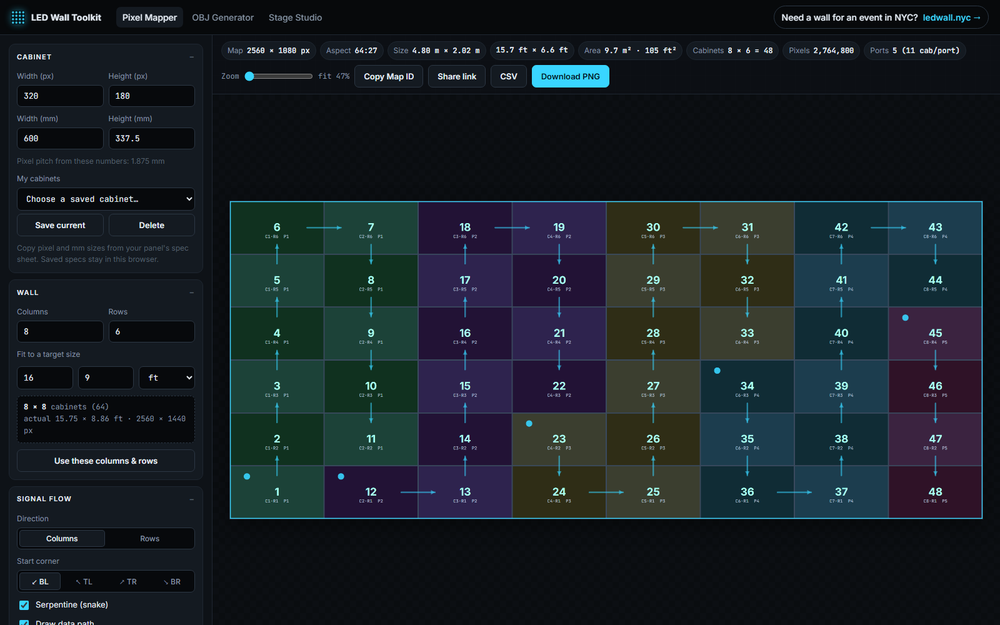

  

<h1 align="center">LED Wall Toolkit</h1>

  <a href="https://tommywu-01.github.io/led-wall-toolkit/"><b>Open the live tools</b></a> · Free, open-source browser tools for LED video walls: pixel maps, OBJ models and 3D stage layouts. 
  No install, no sign-up, and nothing leaves your computer.

  <a href="https://ledwall.nyc/?utm_source=github&utm_medium=readme"><b>Maintained by ledwall.nyc, LED wall rental in New York City →</b></a>

---

> **Need an LED wall for an event in NYC?** [ledwall.nyc](https://ledwall.nyc/?utm_source=github&utm_medium=readme) rents LED video walls with delivery, setup and an on-site technician across the five boroughs, Jersey City and Hoboken. Day rates are published on the [pricing page](https://ledwall.nyc/pricing?utm_source=github&utm_medium=readme).

## Tools

| Tool | What it does |
|---|---|
| **[Pixel Mapper](pixel-mapper.html)** | Draws a pixel-exact map of any cabinet grid and exports a **1:1 PNG** for your media server or processor. Cabinet numbers, serpentine or straight signal path from any corner, data-port splits, corner coordinates in px / m / ft, logo and title, power and amp estimates, build-time estimate, CSV cabinet list, and shareable links. |
| **[OBJ Generator](obj-generator.html)** | Builds an OBJ + MTL of a flat or U-shaped wall at real scale, with UVs that line up with the pixel map. Live 3D preview with your own texture. |
| **[Stage Studio](stage-studio.html)** | Lays out several walls, floors and ceilings in 3D with snapping and exact transforms, saves layouts, and exports every surface. Optional AI preview with **your own** Gemini API key. |

## Use it

**Online:** https://tommywu-01.github.io/led-wall-toolkit/

**Offline:** download the repo and open `index.html` in Chrome, Edge, Firefox or Safari. Each tool is one HTML file; the 3D tools load three.js from a CDN.

## Pixel Mapper quick start

1. Enter one cabinet's size in pixels and mm (from the panel spec sheet). Pixel pitch is worked out for you. Save it under **My cabinets** to reuse it.
2. Enter columns × rows, or type a target size in ft / m / in and press **Use these columns & rows**.
3. Choose the signal flow: columns or rows, start corner, serpentine on or off. Set **pixels per data port** to see where each port's run starts and ends (0 turns it off).
4. Press **Download PNG**. The file is exactly *columns × cabinet width* by *rows × cabinet height* pixels.
5. **Share link** copies a URL that rebuilds the same map. **CSV** exports every cabinet's index, port, column, row and pixel rectangle.

Power, amps and build time are rough planning numbers. Always check the processor and cabinet spec sheets, and use a licensed electrician for real power plans.

## Privacy

Everything runs locally in your browser. Settings and logos are kept in your browser's `localStorage` only. The optional AI preview in Stage Studio sends the preview image and prompt to Google's Gemini API with the key you enter; the key is stored only in your browser.

## Credits

- **Original tool:** created by **[Tommy Wu (@tommywu-01)](https://github.com/tommywu-01)**. This repo is a cleaned-up, redesigned version of that work.
- **Maintained by:** [ledwall.nyc](https://ledwall.nyc/?utm_source=github&utm_medium=readme), LED wall rental in NYC.
- Built with [three.js](https://threejs.org/) (MIT), [Inter](https://rsms.me/inter/) and [JetBrains Mono](https://www.jetbrains.com/lp/mono/) (SIL OFL).

## Contributing

Issues and pull requests are welcome: new signal-flow patterns, processor port presets, export formats or translations. Keep each tool a single HTML file with no build step.

## License

[MIT](LICENSE)
